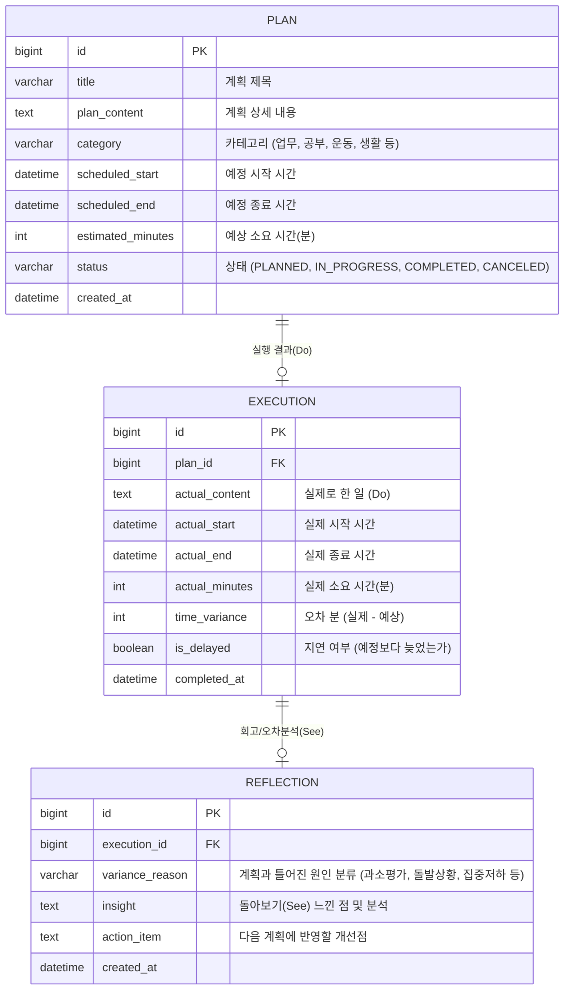

# 🏗️ 플랜두씨(Plan-Do-See) 다이어리: 시스템 아키텍처 설계 지침서 (V1.0)

## 0. 프로젝트 개요 및 아키텍처 목표
- **페르소나**: 15년 차 실무 시니어 아키텍트 (안정성, 데이터 정합성, 유지보수성 최우선).
- **목표**: 무로그인 단일 환경에서 계획(Plan) ➔ 실행(Do) ➔ 회고(See) 라이프사이클을 영속화하고, "계획 오차 통계 집계"와 "집계 숫자 클릭 시 상세 기록으로의 드릴다운(Drill-down)"을 지원하는 Spring Boot 3.x + MySQL 웹 아키텍처 구축.
- **핵심 키워드**: Plan-Do-See Cascade Lifecycle, Drill-down Query, Zero-Auth Single Tenant, XSS/Secret Defense.

---

## 1. 시스템 흐름도 & 라이프사이클 아키텍처 (HLD)

```mermaid
graph TD
    User[사용자 브라우저] -->|1. 초기 접속| View[Thymeleaf SSR: 무로그인 안내 배너 + 대시보드 레이아웃]
    User -->|2. Plan 등록 / Do 기록 / See 작성| API[Spring Boot REST Controller]
    API -->|3. 유효성 검증 & 비즈니스 로직| Service[PlanDoSee Service: @Transactional]
    Service -->|4. 영속화| DB[(MySQL: plans, executions, reflections)]
    
    User -->|5. 집계 숫자 카드 클릭| Drilldown[집계 드릴다운: ?filter=delayed | ?category=xxx]
    Drilldown -->|6. 비동기 Fetch or 쿼리 파라미터 필터링| API
    API -->|7. 필터링된 기록 리스트 반환| View
```

---

## 2. 도메인 데이터 모델링 (ERD 설계)

Plan, Do, See의 인과관계와 오차 분석이 명확히 연결되도록 설계한다.



---

## 3. 집계(Aggregation) 및 드릴다운(Drill-down) 아키텍처

과제 핵심 요건인 **"집계 숫자를 눌러 그 숫자가 나온 기록으로 갈 수 있습니다"**를 위한 설계:

1. **대시보드 집계 DTO (`DashboardSummaryDto`)**:
   - `totalPlans`: 전체 계획 건수
   - `completedCount`: 완료된 실행 건수
   - `delayedCount`: 예정보다 지연되거나 초과된 건수 (시간 오차 > 0)
   - `unreflectedCount`: Do는 끝났으나 See(회고)가 작성되지 않은 건수
   - `topVarianceReason`: 가장 빈번한 계획 오차 원인 (예: "소요시간 과소평가 5건")
2. **드릴다운 쿼리 파라미터 매핑**:
   - `GET /?status=delayed` ➔ `delayedCount` 숫자 클릭 시 지연 목록으로 필터링
   - `GET /?status=completed` ➔ 완료 목록으로 필터링
   - `GET /?needReview=true` ➔ 회고 대기 목록으로 필터링
   - `GET /?reason=과소평가` ➔ 해당 오차 원인의 기록들만 모아서 조회
3. **사용자 경험 (UX)**:
   - 숫자 카드에 배지 및 하이라이트 효과 적용
   - 클릭 시 URL 쿼리 파라미터 동기화(새로고침/공유 시에도 해당 필터 상태 유지)

---

## 4. 보안 및 비기능 요구사항 (NFR)

1. **무로그인 공개 환경 보안**:
   - 사용자가 URL만으로 접근 가능하므로 비밀번호나 민감 개인정보 입력을 방지하는 배너 상단 고정.
   - 데이터 삭제/수정 시 간단한 확인 팝업(Confirm) 처리.
2. **XSS 및 스크립트 인젝션 차단**:
   - 사용자가 회고나 계획에 스크립트 태그(`<script>`, ``)를 입력해도 브라우저에서 실행되지 않도록, Thymeleaf 기본 HTML Escaping(`th:text`) 철저 준수.
3. **비밀값 및 환경변수 노출 방지 (GitHub 공개 대비)**:
   - MySQL 접속 계정, 포트, 패스워드는 `application.yml`에 하드코딩하지 않고 환경변수(`SPRING_DATASOURCE_URL`, `SPRING_DATASOURCE_USERNAME`, `SPRING_DATASOURCE_PASSWORD`) 또는 로컬 전용 설정 파일(`application-local.yml`, `.gitignore`)로 격리.
4. **새로고침 영속성 보장**:
   - 모든 쓰기 작업은 DB 트랜잭션 커밋 완료 후 클라이언트에 200/201 응답을 주며, 브라우저 새로고침(F5) 시 즉시 DB에서 최신 데이터를 렌더링.